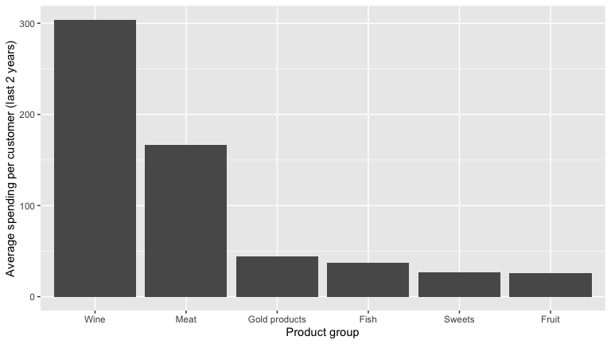
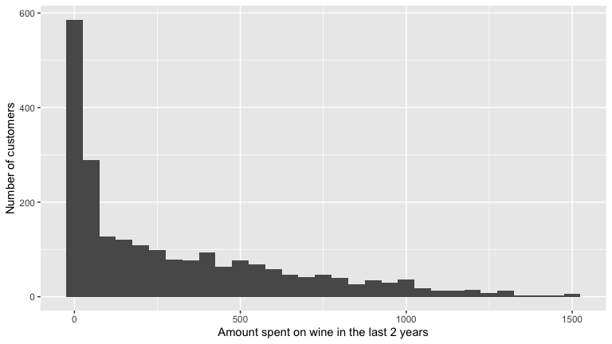
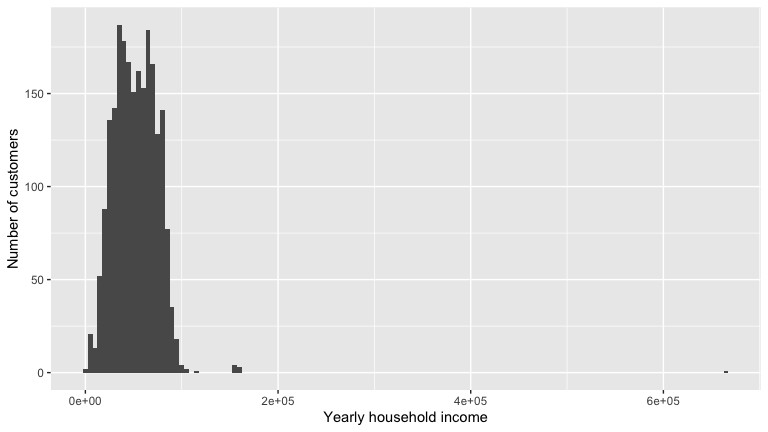
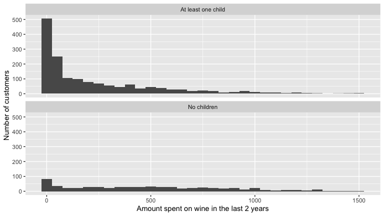
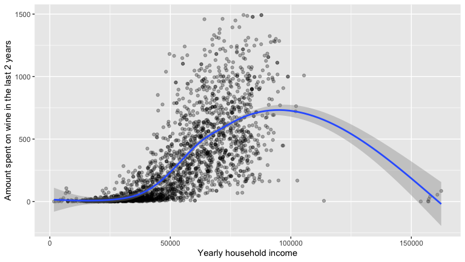

Customer Spending Analysis
================

- [Summary](#summary)
- [Reading in the data](#reading-in-the-data)
- [Checking the data](#checking-the-data)
  - [Missing values](#missing-values)
  - [Unusual values](#unusual-values)
  - [Categories and repeated rows](#categories-and-repeated-rows)
  - [Enrolment dates](#enrolment-dates)
- [What do customers spend money on?](#what-do-customers-spend-money-on)
- [Is the average customer income
  €42,000?](#is-the-average-customer-income-42000)
- [Do customers with children at home spend less on
  wine?](#do-customers-with-children-at-home-spend-less-on-wine)
- [Is it the children, or the
  income?](#is-it-the-children-or-the-income)
- [Do people with a PhD earn more than people with a
  Master’s?](#do-people-with-a-phd-earn-more-than-people-with-a-masters)
  - [How often does a small sample miss this
    difference?](#how-often-does-a-small-sample-miss-this-difference)
- [Limitations](#limitations)
- [Reproducing this report](#reproducing-this-report)

# Summary

This report analyses the spending and background of 2,240 customers of a
grocery store, using $t$-tests and a simple regression. It asks three
questions: what do customers spend their money on, how does their income
compare with the local average, and do customers with children at home
spend less on wine?

Key findings:

- **Wine is half of all spending.** Of the average €606 that a customer
  spent over two years on six product groups, €304 (50%) went on wine,
  followed by meat (€167, 28%)
- **Customers are richer than the local average.** Their mean yearly
  household income is €52,247 (95% CI €51,199 to €53,296), about €10,200
  above the local average of €42,000. This does not depend on one
  impossible income of 666,666 in the data
- **Customers with children at home spend much less on wine.** They
  spent €231 on average, against €487 for customers without children, a
  difference of €256 (95% CI €224 to €288 less)
- **Most of that gap is explained by income.** Parents have lower
  incomes (€46,474 against €65,706). When income is held constant,
  parents’ wine spending is only €58 lower (95% CI €33 to €83 lower),
  about a fifth of the raw gap
- **Small samples usually miss real differences.** People with a PhD
  earn about €3,200 more than people with a Master’s in these data, but
  random samples of 100 customers fail to detect this about 90% of the
  time

------------------------------------------------------------------------

# Reading in the data

The data have one row per customer. The file is `customer_data.csv`,
saved in the same folder as this document

``` r
customers <- read_csv("customer_data.csv")
glimpse(customers)
```

    ## Rows: 2,240
    ## Columns: 20
    ## $ ID                  <dbl> 5524, 2174, 4141, 6182, 5324, 7446, 965, 6177, 4855, 5899, 1994, 387, …
    ## $ Year_Birth          <dbl> 1957, 1954, 1965, 1984, 1981, 1967, 1971, 1985, 1974, 1950, 1983, 1976…
    ## $ Education           <chr> "Graduation", "Graduation", "Graduation", "Graduation", "PhD", "Master…
    ## $ Marital_Status      <chr> "Single", "Single", "Together", "Together", "Married", "Together", "Di…
    ## $ Income              <dbl> 58138, 46344, 71613, 26646, 58293, 62513, 55635, 33454, 30351, 5648, N…
    ## $ Kidhome             <dbl> 0, 1, 0, 1, 1, 0, 0, 1, 1, 1, 1, 0, 0, 1, 0, 0, 1, 0, 0, 1, 0, 1, 0, 0…
    ## $ Teenhome            <dbl> 0, 1, 0, 0, 0, 1, 1, 0, 0, 1, 0, 0, 0, 1, 0, 0, 1, 0, 1, 0, 0, 0, 1, 1…
    ## $ Dt_Customer         <chr> "04-09-2012", "08-03-2014", "21-08-2013", "10-02-2014", "19-01-2014", …
    ## $ MntWines            <dbl> 635, 11, 426, 11, 173, 520, 235, 76, 14, 28, 5, 6, 194, 233, 3, 1006, …
    ## $ MntFruits           <dbl> 88, 1, 49, 4, 43, 42, 65, 10, 0, 0, 5, 16, 61, 2, 14, 22, 5, 5, 80, 17…
    ## $ MntMeatProducts     <dbl> 546, 6, 127, 20, 118, 98, 164, 56, 24, 6, 6, 11, 480, 53, 17, 115, 19,…
    ## $ MntFishProducts     <dbl> 172, 2, 111, 10, 46, 0, 50, 3, 3, 1, 0, 11, 225, 3, 6, 59, 2, 150, 0, …
    ## $ MntSweetProducts    <dbl> 88, 1, 21, 3, 27, 42, 49, 1, 3, 1, 2, 1, 112, 5, 1, 68, 13, 12, 16, 24…
    ## $ MntGoldProds        <dbl> 88, 6, 42, 5, 15, 14, 27, 23, 2, 13, 1, 16, 30, 14, 5, 45, 4, 28, 176,…
    ## $ NumDealsPurchases   <dbl> 3, 2, 1, 2, 5, 2, 4, 2, 1, 1, 1, 1, 1, 3, 1, 1, 3, 2, 2, 2, 1, 15, 3, …
    ## $ NumWebPurchases     <dbl> 8, 1, 8, 2, 5, 6, 7, 4, 3, 1, 1, 2, 3, 6, 1, 7, 3, 4, 11, 2, 4, 0, 2, …
    ## $ NumCatalogPurchases <dbl> 10, 1, 2, 0, 3, 4, 3, 0, 0, 0, 0, 0, 4, 1, 0, 6, 0, 1, 4, 1, 2, 28, 3,…
    ## $ NumStorePurchases   <dbl> 4, 2, 10, 4, 6, 10, 7, 4, 2, 0, 2, 3, 8, 5, 3, 12, 3, 6, 9, 3, 5, 0, 9…
    ## $ NumWebVisitsMonth   <dbl> 7, 5, 4, 6, 5, 6, 6, 8, 9, 20, 7, 8, 2, 6, 8, 3, 8, 7, 5, 6, 8, 1, 8, …
    ## $ Complain            <dbl> 0, 0, 0, 0, 0, 0, 0, 0, 0, 0, 0, 0, 0, 0, 0, 0, 0, 0, 0, 0, 0, 0, 0, 0…

There are 2,240 customers and 20 variables. The variables used in this
report are

| Variable | Description |
|----|----|
| `ID` | Customer identifier |
| `Year_Birth` | Year of birth |
| `Education` | Education level (Basic, 2n Cycle, Graduation, Master, PhD) |
| `Marital_Status` | Marital status |
| `Income` | Yearly household income in euros |
| `Kidhome` | Number of young children in the home |
| `Teenhome` | Number of teenagers in the home |
| `Dt_Customer` | Date the customer enrolled, written day-month-year |
| `MntWines` | Amount spent on wine in the last 2 years |
| `MntFruits` | Amount spent on fruit in the last 2 years |
| `MntMeatProducts` | Amount spent on meat in the last 2 years |
| `MntFishProducts` | Amount spent on fish in the last 2 years |
| `MntSweetProducts` | Amount spent on sweets in the last 2 years |
| `MntGoldProds` | Amount spent on gold (premium) products in the last 2 years |

------------------------------------------------------------------------

# Checking the data

Before any analysis, I check for missing values, impossible values, odd
categories and repeated rows

## Missing values

``` r
customers %>%
  summarise(across(everything(), ~ sum(is.na(.)))) %>%
  select(where(~ . > 0))
```

    ## # A tibble: 1 × 1
    ##   Income
    ##    <int>
    ## 1     24

Only `Income` has missing values: 24 customers

## Unusual values

``` r
customers %>%
  arrange(desc(Income)) %>%
  select(ID, Education, Income) %>%
  slice_head(n=5)
```

    ## # A tibble: 5 × 3
    ##      ID Education  Income
    ##   <dbl> <chr>       <dbl>
    ## 1  9432 Graduation 666666
    ## 2  1503 PhD        162397
    ## 3  1501 PhD        160803
    ## 4  5336 Master     157733
    ## 5  8475 PhD        157243

``` r
customers %>%
  arrange(Year_Birth) %>%
  select(ID, Year_Birth, Income) %>%
  slice_head(n=5)
```

    ## # A tibble: 5 × 3
    ##      ID Year_Birth Income
    ##   <dbl>      <dbl>  <dbl>
    ## 1 11004       1893  60182
    ## 2  1150       1899  83532
    ## 3  7829       1900  36640
    ## 4  6663       1940  51141
    ## 5  6932       1941  93027

The largest income, 666,666, is four times the next largest (162,397)
and looks like a data entry error. Three customers were born in 1893,
1899 and 1900, which would make them over 110 years old when they
enrolled. I do not change the original columns. Instead I add a column
`Income.checked` that is missing when the income is the 666,666 value,
and use it wherever the outlier could matter

``` r
customers <- customers %>%
  mutate(Income.checked=if_else(Income > 600000, NA_real_, Income))

customers %>% count(is.na(Income), is.na(Income.checked))
```

    ## # A tibble: 3 × 3
    ##   `is.na(Income)` `is.na(Income.checked)`     n
    ##   <lgl>           <lgl>                   <int>
    ## 1 FALSE           FALSE                    2215
    ## 2 FALSE           TRUE                        1
    ## 3 TRUE            TRUE                       24

## Categories and repeated rows

``` r
customers %>% count(Marital_Status)
```

    ## # A tibble: 8 × 2
    ##   Marital_Status     n
    ##   <chr>          <int>
    ## 1 Absurd             2
    ## 2 Alone              3
    ## 3 Divorced         232
    ## 4 Married          864
    ## 5 Single           480
    ## 6 Together         580
    ## 7 Widow             77
    ## 8 YOLO               2

`Marital_Status` has odd categories: `Absurd` (2 customers), `YOLO` (2)
and `Alone` (3). `Alone` may mean the same as `Single`. I do not use
marital status in the analysis, so I leave it as it is. `Education` has
`2n Cycle` and `Graduation`, which are not self-explanatory

``` r
customers %>% count(Education)
```

    ## # A tibble: 5 × 2
    ##   Education      n
    ##   <chr>      <int>
    ## 1 2n Cycle     203
    ## 2 Basic         54
    ## 3 Graduation  1127
    ## 4 Master       370
    ## 5 PhD          486

Are any customers repeated? `distinct()` keeps only the unique rows once
the ID is ignored

``` r
customers %>%
  select(-ID) %>%
  distinct() %>%
  summarise(unique.rows=n())
```

    ## # A tibble: 1 × 1
    ##   unique.rows
    ##         <int>
    ## 1        2039

Only 2,039 of the 2,240 rows are unique when the ID is ignored, so 201
rows repeat another customer in everything but the ID. They could be
real customers with the same details, or duplicate entries. I keep them
all, and return to this in the limitations

## Enrolment dates

`Dt_Customer` is read as text in day-month-year form, so `dmy()` turns
it into a date

``` r
customers <- customers %>%
  mutate(Dt_Customer=dmy(Dt_Customer))

customers %>% summarise(first=min(Dt_Customer), last=max(Dt_Customer))
```

    ## # A tibble: 1 × 2
    ##   first      last      
    ##   <date>     <date>    
    ## 1 2012-07-30 2014-06-29

Customers enrolled between July 2012 and June 2014

------------------------------------------------------------------------

# What do customers spend money on?

The six spending columns give the amount each customer spent on each
product group. I reshape them into one column of product groups so that
they can be compared

``` r
spending <- customers %>%
  pivot_longer(cols=c(MntWines, MntFruits, MntMeatProducts, MntFishProducts, MntSweetProducts, MntGoldProds),
               names_to="product", values_to="amount") %>%
  mutate(product=factor(product,
                        levels=c("MntWines", "MntMeatProducts", "MntGoldProds", "MntFishProducts", "MntSweetProducts", "MntFruits"),
                        labels=c("Wine", "Meat", "Gold products", "Fish", "Sweets", "Fruit")))

(  spending.by.product <- spending %>%
     group_by(product) %>%
     summarise(mean.spend=mean(amount)) %>%
     mutate(percent.of.total=mean.spend/sum(mean.spend)*100)  ) %>%
  kable(digits=1)
```

| product       | mean.spend | percent.of.total |
|:--------------|-----------:|-----------------:|
| Wine          |      303.9 |             50.2 |
| Meat          |      167.0 |             27.6 |
| Gold products |       44.0 |              7.3 |
| Fish          |       37.5 |              6.2 |
| Sweets        |       27.1 |              4.5 |
| Fruit         |       26.3 |              4.3 |

``` r
ggplot(spending.by.product, aes(x=product, y=mean.spend)) +
  geom_col() +
  labs(x="Product group", y="Average spending per customer (last 2 years)")
```

<figure>

<figcaption aria-hidden="true">Average amount spent per customer on each
product group over two years.</figcaption>
</figure>

The average customer spent €606 across the six groups. Wine accounts for
€304 of that (50.2%), then meat with €167 (27.6%). Fruit and sweets are
small, at €26 and €27 each (about 4% of the total)

The wine spending is very uneven between customers

``` r
ggplot(customers, aes(x=MntWines)) +
  geom_histogram(binwidth=50) +
  labs(x="Amount spent on wine in the last 2 years", y="Number of customers")
```

<figure>

<figcaption aria-hidden="true">Distribution of wine spending per
customer. Each bar is 50 wide.</figcaption>
</figure>

Wine spending is strongly right-skewed. Many customers spend little or
nothing (13 spent nothing at all) while a few spend over 1,000. This
matters for the $t$-tests later, because means describe a skewed
variable less well than they describe a symmetric one

------------------------------------------------------------------------

# Is the average customer income €42,000?

The local area has an average household income of €42,000. If customers
were typical of the local area, their mean income would be the same

``` r
ggplot(customers, aes(x=Income)) +
  geom_histogram(binwidth=5000) +
  labs(x="Yearly household income", y="Number of customers")
```

<figure>

<figcaption aria-hidden="true">Distribution of customer household
income. Each bar is 5,000 wide.</figcaption>
</figure>

Income is right-skewed, and the single extreme value of 666,666 sits far
from every other customer

**Hypotheses.** The null hypothesis is that the mean yearly household
income of customers is €42,000. The alternative hypothesis is that it is
different

``` r
customers %>%
  summarise(mean=mean(Income, na.rm=TRUE), sd=sd(Income, na.rm=TRUE), n=sum(!is.na(Income)))
```

    ## # A tibble: 1 × 3
    ##     mean     sd     n
    ##    <dbl>  <dbl> <int>
    ## 1 52247. 25173.  2216

``` r
customers %>% pull(Income) %>% t.test(mu=42000)
```

    ## 
    ##  One Sample t-test
    ## 
    ## data:  .
    ## t = 19.163, df = 2215, p-value < 2.2e-16
    ## alternative hypothesis: true mean is not equal to 42000
    ## 95 percent confidence interval:
    ##  51198.59 53295.92
    ## sample estimates:
    ## mean of x 
    ##  52247.25

NHST approach: The mean income of customers (€52,247) was significantly
different from €42,000, $t(2215)=19.16$, $p<.001$

Estimation approach: The mean income of customers is €52,247 95% CI
\[€51,199 to €53,296\], which is €10,247 higher than the local average
(95% CI \[€9,199 to €11,296\])

The extreme value could affect this, so I repeat the test with the
checked income column, which leaves it out

``` r
customers %>% pull(Income.checked) %>% t.test(mu=42000)
```

    ## 
    ##  One Sample t-test
    ## 
    ## data:  .
    ## t = 21.797, df = 2214, p-value < 2.2e-16
    ## alternative hypothesis: true mean is not equal to 42000
    ## 95 percent confidence interval:
    ##  51072.91 52866.81
    ## sample estimates:
    ## mean of x 
    ##  51969.86

Without the 666,666 income the mean is €51,970 and the conclusion is the
same, $t(2214)=21.80$, $p<.001$. The result does not depend on that one
customer. The test makes the 24 missing incomes drop out automatically

------------------------------------------------------------------------

# Do customers with children at home spend less on wine?

**Hypotheses.** The null hypothesis is that the mean amount spent on
wine is the same for customers with at least one child at home and
customers with no children at home. The alternative hypothesis is that
the two means differ

A customer has a child at home if `Kidhome` or `Teenhome` is at least 1.
I add this as a new column

``` r
customers <- customers %>%
  mutate(Children=if_else(Kidhome + Teenhome > 0, "At least one child", "No children"))

customers %>%
  group_by(Children) %>%
  summarise(mean=mean(MntWines), median=median(MntWines), sd=sd(MntWines), n=n()) %>%
  kable(digits=1)
```

| Children           |  mean | median |    sd |    n |
|:-------------------|------:|-------:|------:|-----:|
| At least one child | 230.9 |   91.5 | 292.1 | 1602 |
| No children        | 487.3 |  451.0 | 369.6 |  638 |

``` r
ggplot(customers, aes(x=MntWines)) +
  geom_histogram(binwidth=50) +
  facet_wrap(~Children, ncol=1) +
  labs(x="Amount spent on wine in the last 2 years", y="Number of customers")
```

<figure>

<figcaption aria-hidden="true">Wine spending for customers with and
without children at home. Each bar is 50 wide.</figcaption>
</figure>

Customers with children are bunched at very low spending, while
customers without children are spread much further to the right. A
$t$-test compares the means

``` r
t.test(MntWines ~ Children, data=customers)
```

    ## 
    ##  Welch Two Sample t-test
    ## 
    ## data:  MntWines by Children
    ## t = -15.679, df = 969.51, p-value < 2.2e-16
    ## alternative hypothesis: true difference in means between group At least one child and group No children is not equal to 0
    ## 95 percent confidence interval:
    ##  -288.4890 -224.3058
    ## sample estimates:
    ## mean in group At least one child        mean in group No children 
    ##                         230.9082                         487.3056

NHST approach: Customers with at least one child at home spent
significantly less on wine than customers with no children at home,
Welch $t(970)=-15.68$, $p<.001$. The $t$ is negative because R compares
the “At least one child” group with the “No children” group

Estimation approach: Customers with at least one child spent €231 on
average, and customers with no children spent €487. The difference is
€256 less for parents 95% CI \[€224 to €288 less\]

Children can be defined in other ways. Counting only young children
(`Kidhome`), without teenagers, gives the same conclusion: parents of
young children spent €103 and other customers €451, Welch
$t(2112)=-30.49$, $p<.001$

``` r
customers %>%
  mutate(Young.children=if_else(Kidhome > 0, "Young children", "No young children")) %>%
  group_by(Young.children) %>%
  summarise(mean=mean(MntWines), n=n()) %>%
  kable(digits=1)
```

| Young.children    |  mean |    n |
|:------------------|------:|-----:|
| No young children | 451.2 | 1293 |
| Young children    | 102.9 |  947 |

------------------------------------------------------------------------

# Is it the children, or the income?

Parents might spend less on wine because they have less money, not
because they have children. Let us look at the incomes, leaving out the
impossible value

``` r
customers %>%
  group_by(Children) %>%
  summarise(mean.income=mean(Income.checked, na.rm=TRUE), n=sum(!is.na(Income.checked))) %>%
  kable(digits=0)
```

| Children           | mean.income |    n |
|:-------------------|------------:|-----:|
| At least one child |       46474 | 1582 |
| No children        |       65706 |  633 |

``` r
ggplot(customers, aes(x=Income.checked, y=MntWines)) +
  geom_point(alpha=0.3) +
  geom_smooth() +
  labs(x="Yearly household income", y="Amount spent on wine in the last 2 years")
```

<figure>

<figcaption aria-hidden="true">Wine spending against household income.
Each point is one customer. The checked income column leaves out the
666,666 value.</figcaption>
</figure>

Parents have much lower incomes (a mean of €46,474 against €65,706), and
wine spending rises strongly with income (the correlation is .69 once
the impossible income is left out). So the two explanations are tangled
together. A regression that includes both children and income separates
them

``` r
m.wine <- lm(MntWines ~ Children + Income.checked, data=customers)
summary(m.wine)
```

    ## 
    ## Call:
    ## lm(formula = MntWines ~ Children + Income.checked, data = customers)
    ## 
    ## Residuals:
    ##      Min       1Q   Median       3Q      Max 
    ## -1428.38  -132.33   -37.28    90.99  1045.08 
    ## 
    ## Coefficients:
    ##                       Estimate Std. Error t value Pr(>|t|)    
    ## (Intercept)         -2.463e+02  1.367e+01 -18.022  < 2e-16 ***
    ## ChildrenNo children  5.803e+01  1.253e+01   4.633 3.81e-06 ***
    ## Income.checked       1.029e-02  2.629e-04  39.150  < 2e-16 ***
    ## ---
    ## Signif. codes:  0 '***' 0.001 '**' 0.01 '*' 0.05 '.' 0.1 ' ' 1
    ## 
    ## Residual standard error: 243.7 on 2212 degrees of freedom
    ##   (25 observations deleted due to missingness)
    ## Multiple R-squared:  0.4788, Adjusted R-squared:  0.4783 
    ## F-statistic:  1016 on 2 and 2212 DF,  p-value: < 2.2e-16

``` r
confint(m.wine)
```

    ##                             2.5 %        97.5 %
    ## (Intercept)         -2.731563e+02 -219.54349842
    ## ChildrenNo children  3.347014e+01   82.59667753
    ## Income.checked       9.778605e-03    0.01080988

NHST approach: Holding income constant, customers with children at home
still spent significantly less on wine, $t(2212)=-4.63$, $p<.001$.
Income also had a significant positive effect, $t(2212)=39.15$, $p<.001$

Estimation approach: Holding income constant, parents spent €58 less on
wine than customers with no children 95% CI \[€33 to €83 less\]. Each
extra €10,000 of income was associated with €103 more spent on wine

So most of the €256 raw gap is explained by income: once income is held
constant, the gap is about a fifth as large. A real difference remains,
but it is much smaller than the first comparison suggested. This model
assumes that wine spending rises in a straight line with income, which
the smoothed line in the figure only roughly follows, so even the
remaining gap should be treated with some caution

------------------------------------------------------------------------

# Do people with a PhD earn more than people with a Master’s?

Keep only the two education groups, with a known income

``` r
( masters.phd <- customers %>%
    filter(Education %in% c("Master", "PhD"), !is.na(Income)) )
```

    ## # A tibble: 846 × 22
    ##       ID Year_Birth Education Marital_Status Income Kidhome Teenhome Dt_Customer MntWines MntFruits
    ##    <dbl>      <dbl> <chr>     <chr>           <dbl>   <dbl>    <dbl> <date>         <dbl>     <dbl>
    ##  1  5324       1981 PhD       Married         58293       1        0 2014-01-19       173        43
    ##  2  7446       1967 Master    Together        62513       0        1 2013-09-09       520        42
    ##  3  6177       1985 PhD       Married         33454       1        0 2013-05-08        76        10
    ##  4  4855       1974 PhD       Together        30351       1        0 2013-06-06        14         0
    ##  5  5899       1950 PhD       Together         5648       1        1 2014-03-13        28         0
    ##  6  8180       1952 Master    Divorced        59354       1        1 2013-11-15       233         2
    ##  7  2114       1946 PhD       Single          82800       0        0 2012-11-24      1006        22
    ##  8  6565       1949 Master    Married         76995       0        1 2013-03-28      1012        80
    ##  9  1993       1949 PhD       Married         58607       0        1 2012-12-23       867         0
    ## 10  4047       1954 PhD       Married         65324       0        1 2014-01-11       384         0
    ## # ℹ 836 more rows
    ## # ℹ 12 more variables: MntMeatProducts <dbl>, MntFishProducts <dbl>, MntSweetProducts <dbl>,
    ## #   MntGoldProds <dbl>, NumDealsPurchases <dbl>, NumWebPurchases <dbl>, NumCatalogPurchases <dbl>,
    ## #   NumStorePurchases <dbl>, NumWebVisitsMonth <dbl>, Complain <dbl>, Income.checked <dbl>,
    ## #   Children <chr>

``` r
masters.phd %>%
  group_by(Education) %>%
  summarise(mean=mean(Income), sd=sd(Income), n=n()) %>%
  kable(digits=0)
```

| Education |  mean |    sd |   n |
|:----------|------:|------:|----:|
| Master    | 52918 | 20158 | 365 |
| PhD       | 56145 | 20613 | 481 |

**Hypotheses.** The null hypothesis is that mean income is the same for
people with a PhD and people with a Master’s. The alternative hypothesis
is that it differs

``` r
t.test(Income ~ Education, data=masters.phd)
```

    ## 
    ##  Welch Two Sample t-test
    ## 
    ## data:  Income by Education
    ## t = -2.2843, df = 792.47, p-value = 0.02262
    ## alternative hypothesis: true difference in means between group Master and group PhD is not equal to 0
    ## 95 percent confidence interval:
    ##  -6001.4720  -454.0873
    ## sample estimates:
    ## mean in group Master    mean in group PhD 
    ##             52917.53             56145.31

NHST approach: People with a PhD earned significantly more than people
with a Master’s, Welch $t(792)=-2.28$, $p=.023$. The test compares
Master’s with PhD, so a negative $t$ means the PhD mean is higher

Estimation approach: The mean income was €56,145 for people with a PhD
and €52,918 for people with a Master’s. People with a PhD earned €3,228
more 95% CI \[€454 to €6,001\]. The interval is wide: the difference
could be anything from small to fairly large

## How often does a small sample miss this difference?

The difference above is only just significant in 846 people. What if we
only surveyed 100? I take many random samples from these 846 people, run
the same test on each, and count how often the test fails to find that
the PhD group earns more. A sample “finds” the difference only when
$p<.05$ and the PhD mean is higher. The function `slice_sample()` takes
each random sample and `map_dfr()` repeats it 1,000 times. I do not set
a seed, so the proportions change a little every time the report is
knitted

``` r
simulate.failure.rate <- function(sample.size, no.samples=1000) {
  many.samples <- map_dfr(1:no.samples, ~ slice_sample(masters.phd, n=sample.size) %>% mutate(sample=.x))

  many.samples %>%
    group_by(sample) %>%
    summarise(t=t.test(Income ~ Education)$statistic,
              p=t.test(Income ~ Education)$p.value) %>%
    summarise(failed=mean(!(p < 0.05 & t < 0))) %>%
    pull(failed)
}

tibble(sample.size=c(50, 100, 200, 400)) %>%
  mutate(proportion.failed=map_dbl(sample.size, simulate.failure.rate)) %>%
  kable(digits=2)
```

| sample.size | proportion.failed |
|------------:|------------------:|
|          50 |              0.94 |
|         100 |              0.90 |
|         200 |              0.82 |
|         400 |              0.70 |

In a run of this code, the test failed to find the PhD advantage in
about 93% of samples of 50 people, 90% of samples of 100, 82% of samples
of 200 and 71% of samples of 400. The difference is real in the full
data, but a smaller sample has a larger standard error and so usually
misses it. A study of 100 people would nearly always conclude that there
is no difference. Not finding a significant difference is not evidence
that there is none. Only 846 people are available, so samples cannot get
much larger, and a sample of 846 is the whole data set

------------------------------------------------------------------------

# Limitations

- **Confounding.** Income explains most of the link between children and
  wine spending, and other things we have not controlled for (age,
  marital status, education) may explain more. The regression does not
  show that children cause lower wine spending
- **Observational data.** Having children is not randomly assigned, so
  no comparison here is an experiment
- **Skewed spending.** Wine spending is strongly right-skewed, and the
  median for parents (€91.50) is far below their mean (€230.91). With
  groups of 1,602 and 638 customers the $t$-test is fairly robust, but
  the mean may not describe a typical customer
- **Data quality.** There are 24 missing incomes, one impossible income,
  three birth years of 1900 or earlier, unclear marital status
  categories and 201 repeated rows. If the repeats are duplicates, the
  sample is effectively smaller than it looks and the standard errors
  are too small. I did not change the original data
- **Who is in the sample.** These are customers of one store, so the
  results tell us about this store’s customers, not about parents or the
  local population in general. Customers enrolled at different times
  between 2012 and 2014, but spending covers the last two years for
  everyone
- **Definitions.** “Child at home” can be defined in several ways. Young
  children only, or children and teenagers, give the same conclusion
  here, but they give very different gaps (€348 against €256)
- **Sampling experiment.** The simulation reuses the same 846 people, so
  it shows how small samples behave but cannot show how often the PhD
  advantage would appear in a new population

# Reproducing this report

1.  Save `customer_data.csv` next to this `.Rmd`
2.  Install the packages with
    `install.packages(c("tidyverse", "knitr"))`
3.  Knit the document in RStudio, or run
    `rmarkdown::render("Customer-Spending-Analysis-Report.Rmd")`
