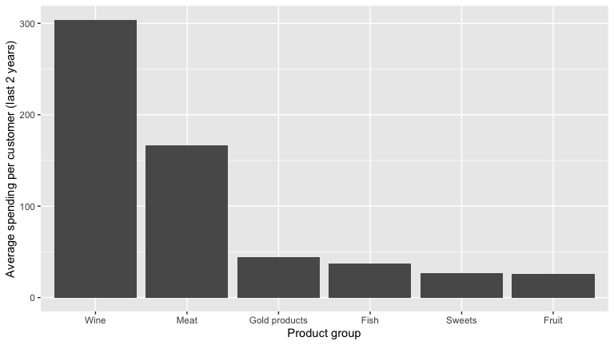
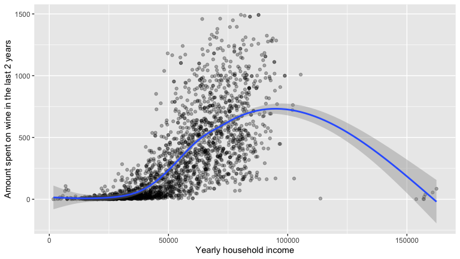

# Customer Spending Analysis

**Question:** Do grocery customers with children at home spend less on wine, and is that because of the children or because of their income?

This project analyses the spending and background of 2,240 customers of a grocery store in R, using t-tests and a regression, and finishes with a simulation of how often small samples miss a real difference.

**[Read the full report →](Customer-Spending-Analysis-Report.md)**

---

## Key findings

| | |
|---|---|
| **50%** | Share of customer spending that goes on wine (€304 of €606 over two years) |
| **€256 → €58** | Parents' lower wine spending, before and after holding income constant |
| **~90%** | How often a sample of 100 customers misses a real income difference |

- **Wine is half of all spending**, followed by meat (€167, 28%).
- **Customers are richer than the local area.** Their mean household income is €52,247 (95% CI €51,199 to €53,296), about €10,200 above the local average of €42,000. Removing one impossible income of 666,666 does not change this.
- **Customers with children at home spend much less on wine:** €231 against €487, a gap of €256 (95% CI €224 to €288).
- **Most of that gap is income.** Parents earn less (€46,474 against €65,706), and wine spending rises strongly with income (r = .69). Holding income constant in a regression, parents spend only €58 less (95% CI €33 to €83), about a fifth of the raw gap.
- **Small samples miss real effects.** People with a PhD earn about €3,200 more than people with a Master's, but random samples of 100 fail to detect it about 90% of the time.

## What the analysis covers

- **Data checks first:** 24 missing incomes, one impossible income, three birth years of 1900 or earlier, unclear marital status categories and 201 rows repeated apart from the ID. The original data are left unchanged; a checked income column handles the outlier
- **Spending patterns** across six product groups, and the skew in wine spending
- **One-sample t-test:** customer income against the local average
- **Welch t-test:** wine spending by children at home, with a check using young children only
- **Regression:** separating the effect of children from the effect of income
- **Simulation:** how sample size affects the chance of detecting a real difference, using `slice_sample()` and `map_dfr()`
- **Limitations:** confounding, observational data, skewed spending, data quality and how "children at home" is defined

Each result is reported two ways: as a hypothesis test and as an estimate with a confidence interval.

## Data

`customer_data.csv`: one row per customer, 2,240 customers and 20 variables covering demographics, household income and two years of spending on wine, fruit, meat, fish, sweets and gold products. The data were provided as part of my MSc coursework, so the file is not included here. A similar public dataset, Customer Personality Analysis, is available on Kaggle.

## Reproducing the report

1. Save `customer_data.csv` next to the `.Rmd`
2. Install the packages: `install.packages(c("tidyverse", "knitr"))`
3. Knit `Customer-Spending-Analysis-Report.Rmd` in RStudio

## Tools

R · tidyverse (readr, dplyr, tidyr, ggplot2, lubridate, purrr) · knitr · `t.test()` · `lm()`
